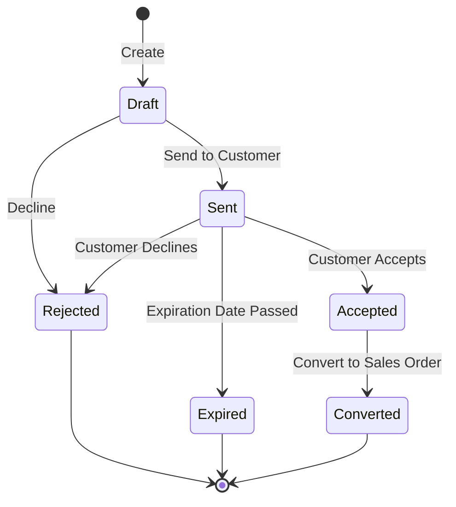
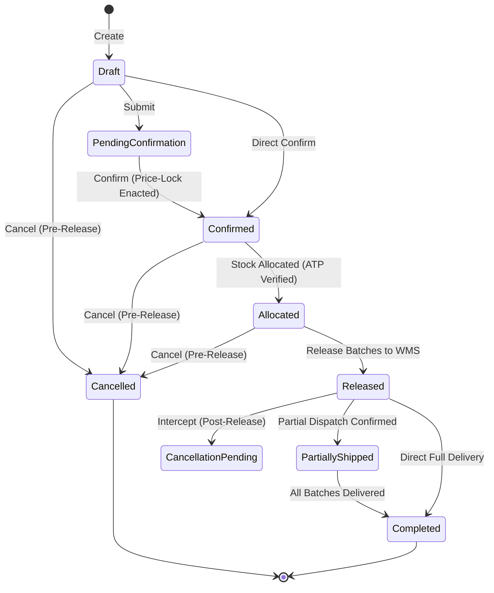
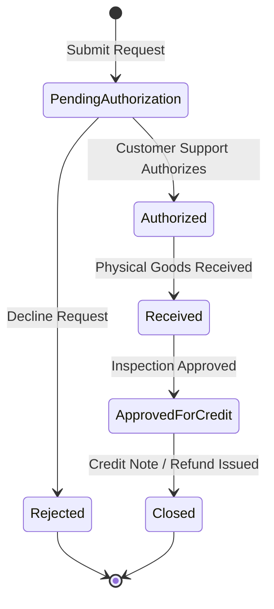

# Sales & OMS Domain Architecture & State Machines Reference

This document provides the foundational architectural specification and state transition graphs for the **Sales & Order Management System (`ium-sales`)** domain module.

---

## 1. Domain Bounded Context & Topology

```text
Omnichannel Ingestion
├── E-Commerce Storefront
├── B2B Wholesale Portal
├── Retail POS Registers
└── Mobile App
        │
        ▼
[ Anti-Corruption Layer (ACL) ]
        │
        ▼
Sales & OMS Domain Core
├── Quotations (Non-binding commercial proposals)
├── Master Sales Orders (Binding customer commitments)
│     ├── Line Items (Commercial price, tax, discount terms)
│     └── Fulfillment Batches (Split shipment instructions)
├── Fulfillment Routing Engine (Sourcing node optimization)
├── Return Merchandise Authorizations (Reverse logistics)
└── Forensic Commercial Audit Log (Append-only snapshots)
```

### Decoupling Rules:
- **Zero Foreign Keys to External Tables**: External entities like products, inventory lots, warehouse bins, carrier records, and customer accounts are referenced exclusively via string morph aliases (`customer_type`, `customer_id`, `orderable_type`, `orderable_id`, `sourcing_node_id`).
- **Headless Domain Invariant**: No HTTP routing, controller logic, Blade views, or frontend presentation assets belong in this package.

---

## 2. Order Hierarchy Tree

```text
Master Sales Order (`ium_sales_orders`)
├── Header (customer alias, channel, currency, payment terms)
├── Line Item 1 (`ium_sales_order_lines`)
├── Line Item 2 (`ium_sales_order_lines`)
│
├── Fulfillment Batch A (`ium_sales_fulfillment_batches`) -> Sourcing Node: WH-EAST
│   ├── Batch Line 1 (Qty: 2 of Line Item 1)
│   └── Shipping Schedule & Carrier Tracking
│
└── Fulfillment Batch B (`ium_sales_fulfillment_batches`) -> Sourcing Node: STORE-WEST
    ├── Batch Line 2 (Qty: 1 of Line Item 2)
    └── Shipping Schedule & Carrier Tracking
```

---

## 3. Operational State Machines

### 3.1 Commercial Quotation State Machine



### 3.2 Master Sales Order State Machine



### 3.3 Return Merchandise Authorization (RMA) State Machine


