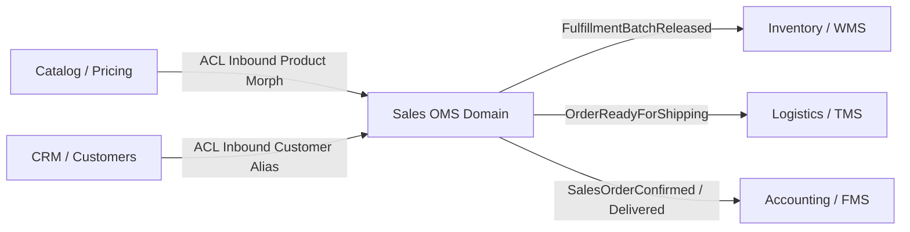

# Cross-Domain Integration & Anti-Corruption Layer (ACL)

The **Sales & Order Management System (`ium-sales`)** interacts with other Obelawium ERP domains through explicit event-driven contracts and an **Anti-Corruption Layer (ACL)**. It maintains zero direct foreign key dependencies on external database schemas.

---

## 1. Domain Relationship Map



---

## 2. Integration with Inventory / WMS

When an order batch is released to fulfillment, `ium-sales` emits `FulfillmentBatchReleased`:

- **WMS Reaction**:
  1. The WMS consumes `FulfillmentBatchReleased`.
  2. Generates warehouse picking lists and packing bins.
  3. Deducts on-hand stock and issues a Goods Issue Note (GIN).
- **Outbound ACL Contract**:
  ```php
  $wmsPayload = ium()->sales()->acl()->exportToWmsPayload($batch);
  // Returns:
  // [
  //   'instruction_type' => 'PICK_PACK_SHIP',
  //   'batch_number' => 'FB-20261027-ABC',
  //   'order_reference' => 'SO-20261027-XYZ',
  //   'sourcing_node_id' => 'WH-CENTRAL',
  //   'items' => [['sku' => 'PROD-1', 'quantity' => 2.0]],
  // ]
  ```

---

## 3. Integration with Logistics / TMS

When parcels are packaged and ready for carrier pickup:

- **TMS Reaction**:
  1. TMS consumes waybill instructions.
  2. Selects optimal carrier by service level.
  3. Emits tracking number and manifest back to OMS via `markBatchShipped()`.
- **Outbound ACL Contract**:
  ```php
  $tmsPayload = ium()->sales()->acl()->exportToTmsPayload($batch);
  // Returns:
  // [
  //   'order_reference' => 'SO-20261027-XYZ',
  //   'batch_number' => 'FB-20261027-ABC',
  //   'destination_address' => [...],
  //   'service_level' => 'EXPRESS',
  //   'carrier_code' => 'FEDEX',
  // ]
  ```

---

## 4. Integration with Accounting / FMS

When a commercial order is confirmed or delivered, revenue must be recognized in the general ledger:

- **Accounting Reaction**:
  1. The Accounting domain consumes commercial events.
  2. Ingests the customer invoice through its own ACL:
     ```php
     ium()->accounting()->acl()->ingest($invoiceDto);
     ```
- **Outbound ACL Contract**:
  ```php
  $fmsPayload = ium()->sales()->acl()->exportToFmsPayload($order);
  // Returns:
  // [
  //   'document_type' => 'CUSTOMER_INVOICE',
  //   'order_reference' => 'SO-20261027-XYZ',
  //   'customer_alias' => 45,
  //   'customer_type' => 'customer',
  //   'currency' => 'USD',
  //   'subtotal' => 600.0,
  //   'discount_total' => 20.0,
  //   'tax_total' => 81.2,
  //   'shipping_total' => 15.0,
  //   'grand_total' => 676.2,
  //   'lines' => [...],
  // ]
  ```
